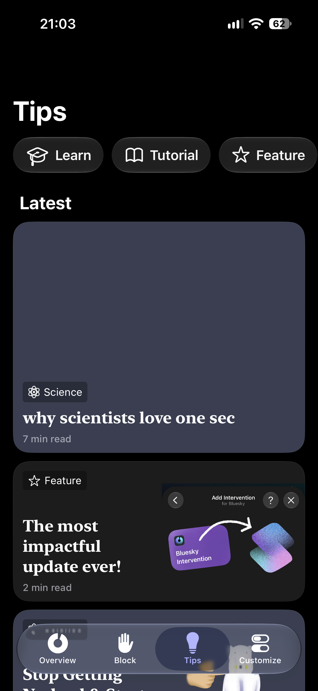
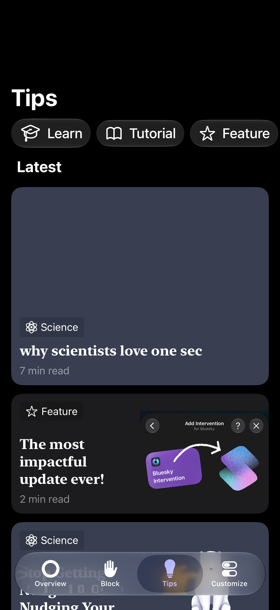
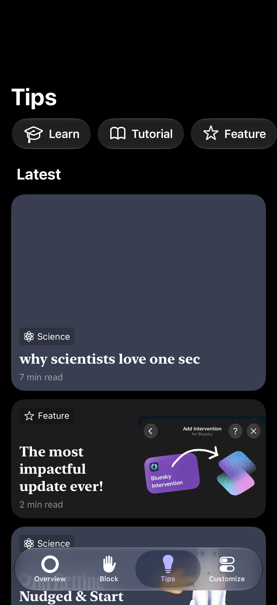
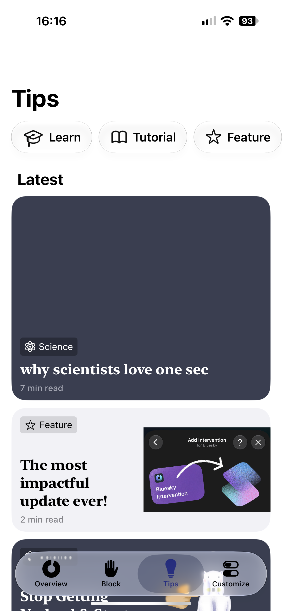
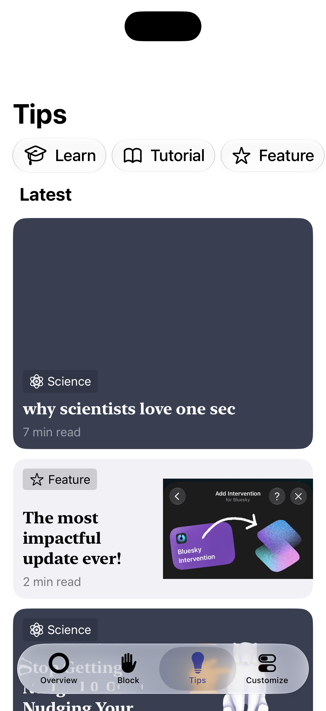
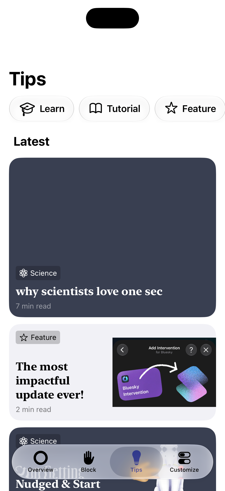

# onesec_mock

用 SwiftUI 模仿 [one sec](https://one-sec.app) 的 Tips 頁面。彼得潘 iOS App 開發課程作業。

## 截圖

深色模式：

| one sec 原版 | 微調前 | 微調後 |
|---|---|---|
|  |  |  |

淺色模式：

| one sec 原版 | 微調前 | 微調後 |
|---|---|---|
|  |  |  |

### 微調內容

- **分類按鈕**：圖示改為對齊文字基線（`HStack(alignment: .firstTextBaseline)`），並用 `.frame(height: 0)` 讓圖示不影響按鈕高度。三個按鈕高度一致，學士帽的位置也和原版相同
- **卡片**：圓角從 16 改為 20
- **標籤與閱讀時間**：字級從 `.subheadline` 縮小為 `.footnote`
- **Latest 標題**：上方間距加大

## 功能

- **Tips 頁**
  - 大標題，捲動後縮成置中的小標題（`NavigationStack` + `.navigationTitle`）
  - 分類按鈕列固定在頂部，使用 Liquid Glass 按鈕（`.safeAreaBar` + `.buttonStyle(.glass)`）
  - Latest：1 張大卡片 + 8 張文章卡片，涵蓋五種底色，以及有圖和無圖兩種排版
  - Categories：四個分類的清單
- **Tab bar**：Overview、Block、Tips、Customize 四個分頁。只有 Tips 有內容

## 檔案結構

| 檔案 | 內容 |
|---|---|
| `ContentView.swift` | `TabView`，四個分頁 |
| `TipsView.swift` | Tips 頁主體，排列下面所有元件 |
| `CategoryChip.swift` | 頂部的 Liquid Glass 分類按鈕 |
| `FeaturedCard.swift` | Latest 的第一張大卡片 |
| `ArticleCard.swift` | 文章卡片，左邊文字、右邊插圖；`imageName` 為 `nil` 時文字佔滿整個寬度 |
| `TagLabel.swift` | 卡片左上角的分類標籤 |
| `CategoryRow.swift` | Categories 清單的單一列 |

## 作業要求對照

| 要求 | 實作 |
|---|---|
| VStack、HStack、ZStack、Text、Image、ScrollView | 卡片排版、清單、直向與橫向捲動 |
| 圖片用到 asset 與 SF Symbol | 文章插圖與卡片底色（Color Set）；分類、Tab bar 圖示 |
| 使用多個 modifier | 字型、padding、背景、圓角、Liquid Glass |
| ScrollView 上下捲動 | Tips 頁整頁；分類按鈕列為橫向捲動 |
| 多個檔案定義 view | 7 個 view 檔案，見上表 |
| 用 property 客製自訂 view | `ArticleCard`、`FeaturedCard`、`TagLabel`、`CategoryChip`、`CategoryRow` 都由參數決定內容 |

## 開發環境

- Xcode 27.1
- iOS 27.0 以上

用 Xcode 開啟 `onesec_mock.xcodeproj`，選擇模擬器或實機後執行。

## 聲明

本專案僅作為課堂練習，與 one sec 及其開發者無關。介面設計與文章插圖的著作權屬於 one sec。
